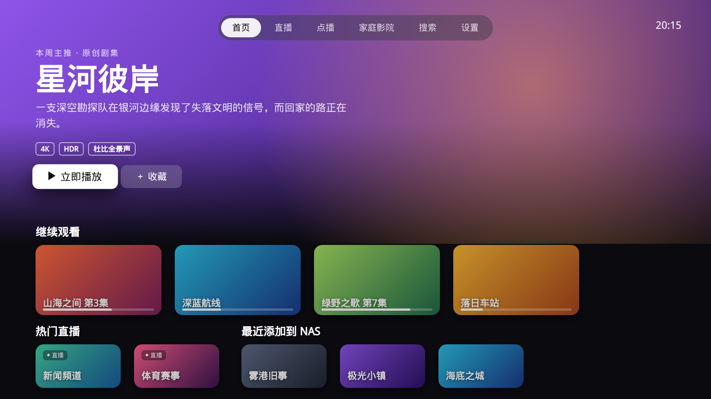
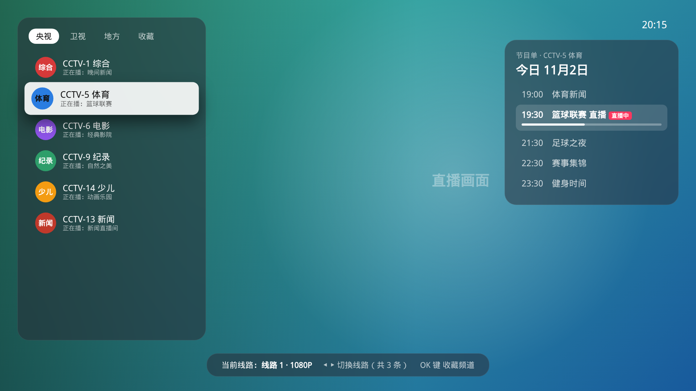
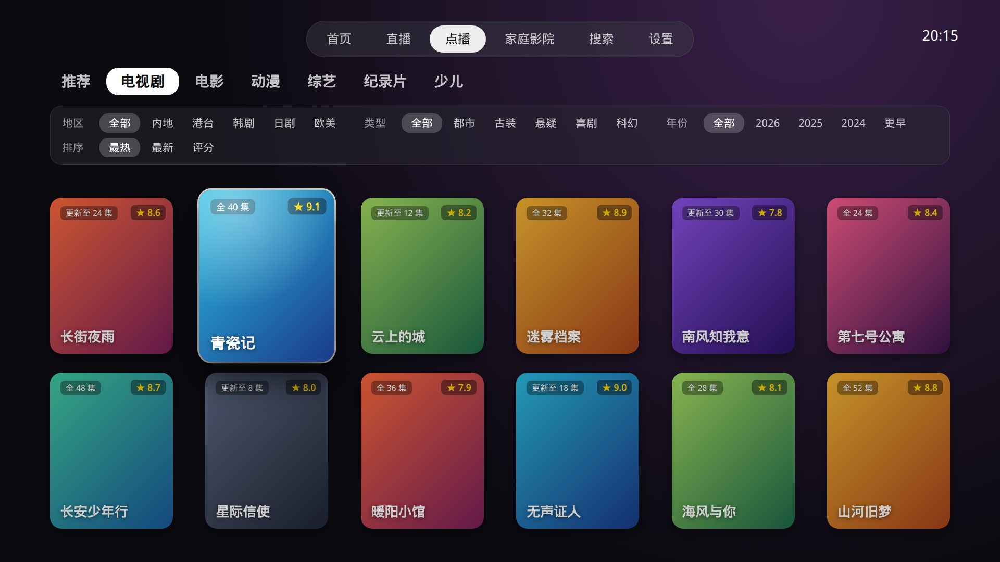
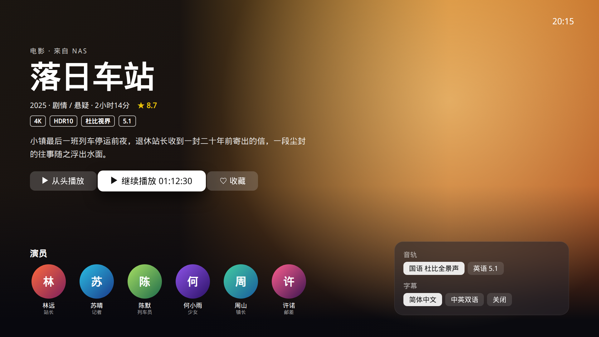
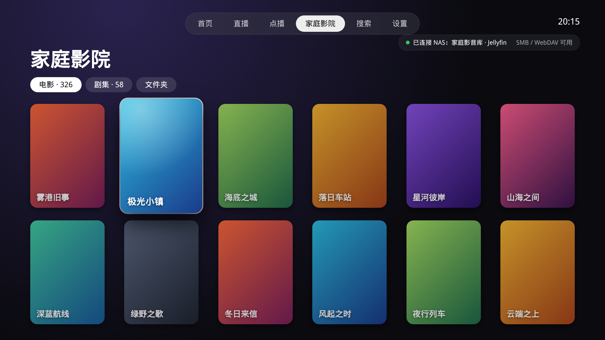

# 家庭影视

面向 Android TV 与电视盒子的家庭播放器。界面按苹果 tvOS 的海报墙来排：顶部胶囊导航、大标题、玻璃态卡片，用遥控器就能完成浏览和播放。

软件本身**只是播放器**。安装包里没有影片库，也没有内置的点播接口。直播使用随仓库附带的公开频道列表；点播要你在设置里填写自己的苹果 CMS 接口；家里的片库通过 Jellyfin、WebDAV 或 SMB 连接。

- 包名：`com.home.tvvideo`
- 技术：Kotlin、Jetpack Compose for TV、Media3（ExoPlayer）
- 最低系统：Android 5.0（API 21），横屏，支持 Leanback 启动器

## 功能

- **直播**：内置 `live.m3u`（来自公开频道列表），按央视、卫视、地方、其他分组。同名频道合并成多条线路，播放失败或长时间缓冲会自动换线。可选节目单（EPG，DIYP 接口）。
- **点播**：对接苹果 CMS（MacCMS）的 JSON 接口（`api.php/provide/vod/`）。默认没有任何源，添加之后才按电影、电视剧、综艺、动漫等分类浏览、筛选和搜索。解析时会跳过标记为成人内容的分类。
- **家庭影院**：
  - Jellyfin：登录后显示电影 / 剧集海报墙，支持续播并把进度回写到服务器
  - WebDAV：按文件夹浏览视频
  - SMB：按共享文件夹浏览（SMB2 / SMB3）
- **播放器**：HLS 与常见容器，快进快退、选集、多线路、音轨、字幕、画面比例；继续观看记录保存在本机。

界面原型（静态 HTML）在 [`prototype/`](prototype/)。

## 界面预览

下面几张图由 `prototype/` 里的 HTML 原型渲染，片名为示意，不是应用内置内容。

| 首页 | 直播 |
| --- | --- |
|  |  |

| 点播 | 详情 |
| --- | --- |
|  |  |

| 家庭影院 |
| --- |
|  |

## 编译

需要 JDK 17（或兼容的更高版本）和 Android SDK，`compileSdk` / `targetSdk` 为 34。Gradle Wrapper 已包含在仓库里，不必单独安装 Gradle。

```bash
# 若还没有 SDK，可用 sdkmanager 安装：
# sdkmanager "platforms;android-34" "build-tools;34.0.0"

export ANDROID_HOME="$HOME/android-sdk"   # 改成你的 SDK 路径
chmod +x ./gradlew
./gradlew assembleDebug
```

调试包路径：

```text
app/build/outputs/apk/debug/app-debug.apk
```

单元测试（解析器，不访问网络）：

```bash
./gradlew testDebugUnitTest
```

推送到 GitHub 时，Actions 工作流 [`.github/workflows/build-debug.yml`](.github/workflows/build-debug.yml) 会执行 `assembleDebug`，并把 APK 作为 artifact 上传（名称 `tvvideo-debug`）。

推送 `v*` 标签（例如 `v1.0.0`）时，[`.github/workflows/release.yml`](.github/workflows/release.yml) 会执行 `assembleRelease`，签名后创建 GitHub Release，并上传 `tvvideo-<标签>.apk`。签名使用仓库 Actions secrets：`KEYSTORE_BASE64`（`.jks` 的 base64）、`KEYSTORE_PASSWORD`（仓库密码和密钥密码相同）、`KEY_ALIAS`。这三个 secret 缺一则工作流会警告，并退回当次生成的临时密钥，那样之后的版本不能覆盖安装。不要把 keystore 提交到仓库。

## 安装

1. 把 `app-debug.apk` 拷到电视或盒子（U 盘、局域网共享，或电脑上执行 `adb install -r app-debug.apk`）。
2. 若系统拦截未知来源，在设置里允许该文件管理器安装应用。
3. 在应用列表或电视桌面的 Leanback 启动器中打开「家庭影视」。

这是 debug 签名包，适合自己安装试用。正式分发前请用你自己的 keystore 打 release 包，不要把 keystore 提交到仓库。

## 遥控器

顶部六个页签：**首页**、**直播**、**点播**、**家庭影院**、**搜索**、**设置**。方向键移动焦点，确认键进入。返回键从内容回到导航；已在导航上时，返回会先回到首页，再按一次退出。

**直播全屏**

| 按键 | 作用 |
| --- | --- |
| 上 / 频道+ | 上一个频道 |
| 下 / 频道− | 下一个频道 |
| 确认、左 | 打开频道列表 |
| 右 | 切换线路 |
| 菜单 | 收藏 / 取消收藏 |

**点播播放**

| 按键 | 作用 |
| --- | --- |
| 左 / 右 | 快退 / 快进，连续按会加快步进 |
| 确认 | 暂停 / 继续 |
| 上 / 下 / 菜单 | 打开面板：选集、线路、音轨、字幕、画面比例 |
| 下一集 / 频道− | 下一集 |
| 上一集 / 频道+ | 上一集 |

搜索页用遥控器调出输入法，输入片名或演员后按确认。

## 添加直播源和点播接口

打开 **设置**。

**点播（苹果 CMS）**

1. 填写名称，以及你自己的 JSON 接口地址，一般形如 `https://example.com/api.php/provide/vod/`。
2. 选「添加」。可以添加多个，点名称切换当前源，也可以删除。
3. 没有源时，「点播」页和首页主推会显示引导，不会去请求任何预设地址。
4. 添加之后回到「点播」即可按分类浏览。搜索页会用当前源查询；若已登录 Jellyfin，搜索也会带上家庭影院结果。

仓库不提供、也不内置任何点播站地址。请只填写你有权使用的接口（例如你自己搭建的 CMS）。`sources/test_vod.py` 可以帮你检查一个**由你传入**的地址是否返回 CMS JSON，它本身不含任何站点列表：

```bash
python3 sources/test_vod.py https://example.com/api.php/provide/vod/
```

**直播**

- 应用会读取 `app/src/main/assets/live.m3u`。同一份列表也放在 [`sources/live.m3u`](sources/live.m3u)，方便对照。公开列表里的频道随时可能失效。
- 在设置里追加自定义 m3u 或 txt（DIYP `分组,#genre#` 格式）地址，再点「远程更新」。同名频道会合并成多线路。
- 节目单可以留空（使用内置的几个公开 DIYP 接口依次尝试），也可以填你自己的模板，需包含 `{ch}` 和 `{date}`。

重新生成或筛选直播列表时，把原始 m3u 放到 `sources/raw/`，再运行 [`sources/test_live.py`](sources/test_live.py)。该脚本只处理本地文件。

**家庭影院**

- Jellyfin：服务器地址（如 `http://192.168.1.10:8096`）、用户名、密码，点登录。
- WebDAV：目录地址、用户名、密码。
- SMB：主机、共享名、用户名、密码。用户名留空则以来宾身份连接。

这些账号只保存在电视本机的 DataStore 里，不会写进源码。

## 免责声明

家庭影视是一个本地播放器，**不提供、不存储、不分发任何影视、直播或其他媒体内容**。

随应用附带的直播列表来自公开频道列表，仅用于演示播放能力，其中的节目是否仍可访问、是否允许你播放，需要你自行判断。点播接口、额外的直播地址，以及 Jellyfin / WebDAV / SMB 上的文件，全部由使用者自己添加。

你应当遵守所在地法律，以及内容权利人、接口提供方和你自己服务器的授权约定。因添加或播放未经授权的源而产生的责任，由使用者自行承担。开发者不提供任何片源，也不对第三方源的合法性、可用性或安全性作保证。

## 许可证

[MIT License](LICENSE)。
